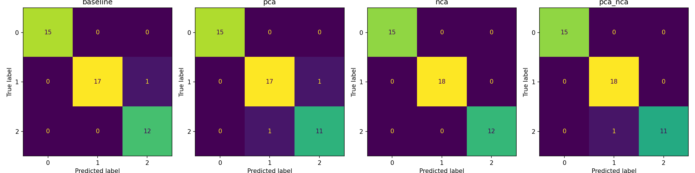

# Wine classification results

Selected by training CV macro-F1: **pca**. Test set: 45 rows; training: 133 rows.

| Pipeline | CV macro-F1 | Test accuracy | Test macro-F1 | Test ROC-AUC (OvR) |
|---|---:|---:|---:|---:|
| baseline | 0.9628 | 0.9778 | 0.9771 | 0.9985 |
| pca | 0.9854 | 0.9556 | 0.9537 | 0.9981 |
| nca | 0.9715 | 1.0000 | 1.0000 | 1.0000 |
| pca_nca | 0.9715 | 0.9778 | 0.9765 | 0.9788 |

One seeded split on a small public dataset. These are demonstration results, not evidence of production performance.

